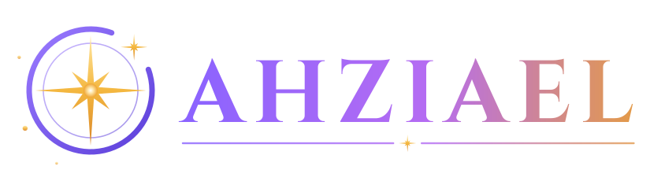

<p align="center">
  
</p>

<h3 align="center">Your own private wizard adventure server. One app, one click.</h3>

<p align="center">
  <a href="https://github.com/Niduus/Imlight/releases/latest"><b>Download</b></a> ·
  <a href="#get-started">Get started</a> ·
  <a href="#whats-in-the-app">The app</a> ·
  <a href="#whats-in-the-game">The game</a> ·
  <a href="#for-developers">Developers</a> ·
  <a href="https://discord.gg/FtVU6dEerP"><b>Discord</b></a>
</p>

<p align="center">
  <a href="https://discord.gg/FtVU6dEerP"></a>
  <br>
  <sub>Join the <a href="https://discord.gg/FtVU6dEerP">Ahziael Discord</a> for news, updates and bug reports.</sub>
</p>

<p align="center">
  <a href="https://github.com/Niduus/Imlight/releases/latest"></a>
  
  <a href="LICENSE"></a>
</p>

---

**Ahziael** sets up and runs a private server for a classic wizard adventure game, right on your own PC. Press **Play** and the game opens on your server, not the official one.

It's built on [Imlight](https://github.com/Revive101/Imlight), the open source server by the Revive101 team, and adds thousands of quests, the game systems Imlight was still missing, new game modes, and an app that does all the technical work for you.

- **No game files are shared.** Ahziael reads what it needs from your own copy of the game.
- **Private servers only.** It refuses to connect to the official game.
- **Nothing to set up by hand.** No code, no command line, no config files.

<sub>A fan project for learning and fun. Not made by, linked to, or supported by the original game's developer or publisher.</sub>

## Get started

You need a Windows PC with **the game installed** and opened at least once.

1. Download **`ImlightManager.exe`** from the [latest version](https://github.com/Niduus/Imlight/releases/latest).
2. Open it. The first setup takes a few minutes. It finds your game, builds your server, asks you to make an admin account, and puts an **Ahziael** shortcut on your desktop.
3. Open **Ahziael** and press **Play**.

Ahziael updates itself each time it opens, and keeps your settings, accounts and characters. To remove it, uninstall it from **Windows Settings > Apps**. It asks before deleting any characters, and never touches your game install.

## What's in the app

One window, eight pages, and a search box that finds any page, setting, command, spell, item, creature, place or quest.

| Page | What it's for |
|---|---|
| **Play** | Play on your server or on other private servers you save. Design your own game overlay. Browse every chat command. |
| **Quests** | Follow your wizard's quests and every world's main story. Start, teleport to or finish any quest, or write your own. |
| **Progress** | Jump to a level or world with the real rewards, find the best gear for your level, and collect or unlearn spells. |
| **Database** | A searchable wiki of the whole game: spells drawn like the game draws them, gear, items, bosses, pets, and every place with one-click teleport. |
| **Create** | Make your own creatures, areas and cheats, and share them with other servers. |
| **Game Rules** | Pick game modes and change how battles, trainers, shops and events work. Turn any NPC, creature, zone or world off. |
| **Server** | Start and stop, change settings, manage accounts, read logs, see who's online, and manage a server on another PC. |
| **Help** | Step-by-step guides, what's new in each version, and credits. |

Almost every setting takes effect right away, with no restart.

## What's in the game

| | |
|---|---|
| **Quests** | 2,400+ extra quests across every world ([full list](data/quest-index.csv)), plus fixes to many more. Type `.stuck` if a quest ever stops you. |
| **Combat** | Criticals and blocks, Archmastery, Shadow magic, school pips, minions, Spell Fusion, spell upgrades, enchantments, treasure cards, real boss cheats (editable), and ranked PvP. |
| **Pets** | Care, snacks, levels, talents, jewels, hatching and the hatch kiosk, pet games and the Pet Derby. |
| **Housing and hobbies** | Houses, Castle Magic, crafting, gardening, fishing, the seamstress, Photomancy, cantrips, and mounts (including two-seaters). |
| **Friends and shopping** | Groups, Team Up, trading, guilds, mail, the Bazaar, the Crown Shop, the Loyalty Store and promo codes. |
| **Endgame** | Dungeons, Deckathalon towers, guild raids and the Guild Museum. |
| **Game modes** | **Randomizer** (shuffles schools, spells, drops and creatures, with seeds, a race mode and a quest-safe Tame mode), **Die = Delete**, Astral schools, open every door, and more. |
| **Your creations** | Custom creatures with their own stats, deck, cheats and drops (`.joinme <creature> <number>`), and custom areas with their own exits, NPCs and bosses. |
| **Commands** | Dozens of chat commands. Type `.help` to list them, or `.tp` and a place's name (even part of it) to go there. |

<sub>Some content comes from data the game doesn't include, like quests, drops and shop lists. It's filled in from <a href="https://github.com/Revive101/spiraldb">SpiralDB</a> and this repository's <a href="data">data folder</a>, so a few areas may still be missing pieces.</sub>

## Playing with friends

- Friends install Ahziael and add your server's address on the **Play** page.
- It works on the same PC, on your home network, and over the internet.
- Other admins can manage your server from their own PC (**Server > Remote**, encrypted, admins only).
- Players can move their account to another server with **Account Transfer**.

---

## How it's made

Ahziael is **vibecoded**: it's built by describing what it should do in plain words, with the code written by **Claude Opus 5.5**. If you want to keep building on it, Opus 5.5 is the recommended model.

## For developers

You don't need anything below to play.

<details>
<summary><b>Run the server by hand</b> (Linux, or without the app)</summary>

<br>

You'll need the [.NET 10 SDK](https://dotnet.microsoft.com/download), your own copy of the game client, and a patch server such as [Aurorium](https://github.com/Revive101/Aurorium) (set `PatchServerInternalUrl` in `[Patch Server]`). Player data uses [RavenDB](https://ravendb.net/); leave `PlayerDatabaseUrl` empty and an embedded one starts by itself.

Settings are in `Imlight.ini` (`src/Imlight.Director/Config/`, copied to `Config/` on build), and each one is explained in the file. **Change `AdminAccountUsername` and `AdminAccountPassword` before the first start.**

```bash
dotnet run --project src/Imlight.Director
```

When the log says `Imlight may now be connected to.`, start the game with `-L 127.0.0.1 12000`.

</details>

<details>
<summary><b>Build from source</b></summary>

<br>

```bash
git clone --recurse-submodules https://github.com/Niduus/Imlight.git
```

[Imcodec](https://github.com/Jooty/Imcodec) (a submodule) generates code from the game's own definitions, which aren't shared here. Before building:

1. Copy a type dump JSON (the newest in `data/typedump/`, or one from [wiztype](https://github.com/wizspoil/wiztype)) into `submodule/Imcodec/src/Imcodec.ObjectProperty/GeneratorInput/`.
2. Unpack your `Root.wad` with `imcodec wad unpack` and copy the `*Messages*.xml` files into `submodule/Imcodec/src/Imcodec.MessageLayer/GeneratorInput/`.

```bash
# The server
dotnet build src/Imlight.sln

# The Ahziael app
dotnet publish src/Imlight.Setup -c Release -r win-x64 --self-contained true -p:PublishSingleFile=true -p:ImlightEdition=Manager
```

App details and installer options: [src/Imlight.Setup/README.md](src/Imlight.Setup/README.md).

</details>

<details>
<summary><b>What's where</b></summary>

<br>

| Folder | Contents |
|---|---|
| [`src/`](src) | The server and the Ahziael app |
| [`data/`](data) | Quests, drops, decks, shops, zone exits and boss cheats added on top of SpiralDB ([guide](data/README.md)) |
| [`overlay-addons/`](overlay-addons) | Overlay add-ons you can download inside Ahziael |
| [`installer/`](installer) | A lighter installer for dedicated server hosts |
| [`tools/`](tools) | Scripts that build the records in `data/` |
| [`docs/`](docs) | How the server works, and the patch notes |

Every folder in more detail: [FOLDER-MAP.md](FOLDER-MAP.md). Sending a change: [CONTRIBUTING.md](CONTRIBUTING.md).

</details>

## Credits

Ahziael stands on the work of a lot of people. Thank you all.

| Who | For |
|---|---|
| **Revive101 team** | [Imlight](https://github.com/Revive101/Imlight), the server this project is built on, and [SpiralDB](https://github.com/Revive101/spiraldb), its world data |
| **Phill** | [Aurorium](https://github.com/Revive101/Aurorium), the open source patch server |
| **Jooty** | [Imcodec](https://github.com/Jooty/Imcodec), which reads the game's file formats |
| **Atmoplex** | Wizard404, for its wiki data |
| **Kronos team** | The [Grimoire](https://kronos-project.github.io/grimoire/foreword.html), notes on how the game works |
| **Revive101 community and QA** | Finding and hunting down bugs |
| **Mitsu** | Being the first person to break Ahziael so badly it had to be reinstalled. Top-tier QA! |

<p align="center"><b>Created by Niduus</b></p>

## License

Like Imlight, Ahziael is licensed under the [GNU Affero General Public License v3.0](LICENSE).
